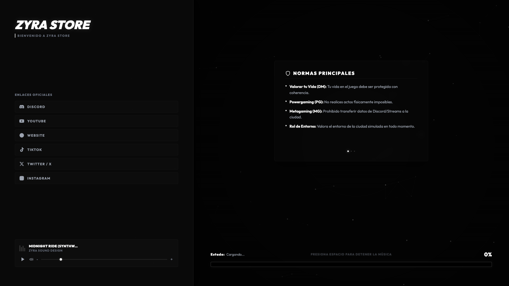
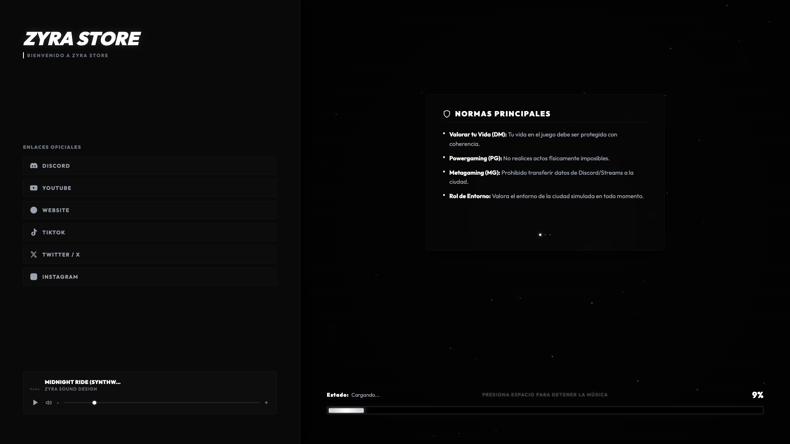

# ❄️ Zyra Loading Screen 2 - Neo-Glassmorphism Edition

Welcome to **Zyra-Loading-Screen-2**, a premium FiveM loading screen resource by **Zyra Store**. Built with an ultra-clean Neo-Glassmorphism aesthetic using frosted semi-transparent glass cards, modern typography, and smooth NUI progress tracking.

---

## 📸 Preview Showcase





---

## 🛠️ Key Features

- **Neo-Glassmorphism Aesthetic:** Translucent frosted glass NUI panels with subtle drop-shadows and vibrant glowing borders.
- **Dynamic Particle Backdrop:** HTML5 canvas background with interactive particle connections.
- **Audio Equalizer & Player:** Playlist controller featuring track title, artist info, volume bar, and mute toggles.
- **Community Info & Rules Modal:** Clean modular cards for server updates, roleplay guidelines, and community announcements.
- **Social Media Grid:** Quick access icons for Discord, Web, Tebex Store, Twitch, and YouTube.
- **Seamless Setup:** Fully customizable via `config.js`.

---

## 📦 Installation Instructions

1. **Copy the Resource:**
   Move the `Zyra-Loading-Screen-2` folder into your FiveM server's `resources` directory:
   `resources/[zyra]/Zyra-Loading-Screen-2`

2. **Update `server.cfg`:**
   Add the start line to your `server.cfg`:
   ```cfg
   ensure Zyra-Loading-Screen-2
   ```

3. **Launch Resource:**
   Save changes and restart your server or execute in your server console:
   ```cmd
   refresh
   ensure Zyra-Loading-Screen-2
   ```

---

## ⚙️ Configuration Guide (`config.js`)

Edit `config.js` to align the design with your server branding:

- **Server Info:** Customize your community title, tagline, and logo branding.
- **Audio Settings:** Manage your MP3 playlist, track details, and autoplay volume.
- **Community Links:** Set your Discord invite link, website URL, and store link.
- **Rules & News:** Modify the server rule accordion and update logs.

---

## ⛔ License & Commercial Restrictions

> [!CAUTION]
> **RESALE IS STRICTLY PROHIBITED (OPEN CODE RESOURCE)**
> This resource is released as **Open Code / Open Source**. Selling, re-selling, monetizing, or offering this resource on Tebex, Discord, or any commercial platform is **STRICTLY PROHIBITED**. You are permitted to modify and use this code freely on your personal FiveM servers, but commercial distribution is prohibited by **Zyra Store**.

---

## 💎 Credits & Support

Developed with ❤️ by **Zyra Store**.  
All rights reserved.
